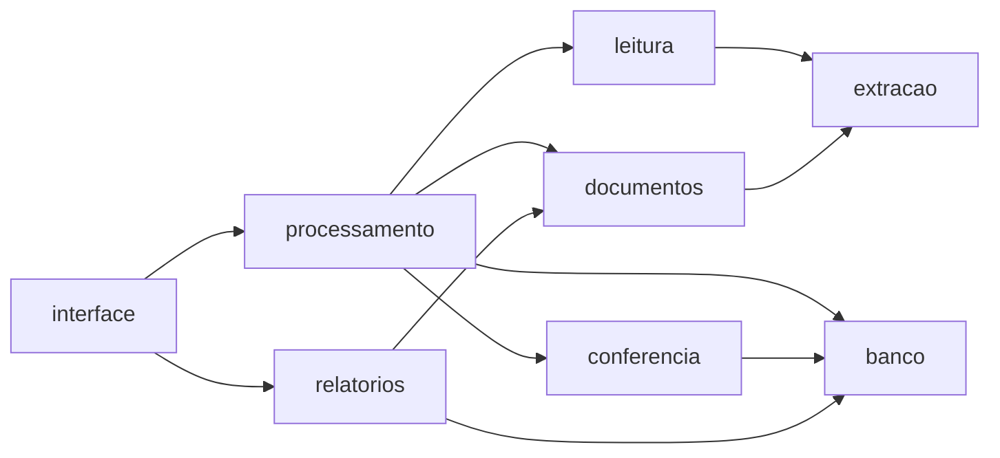
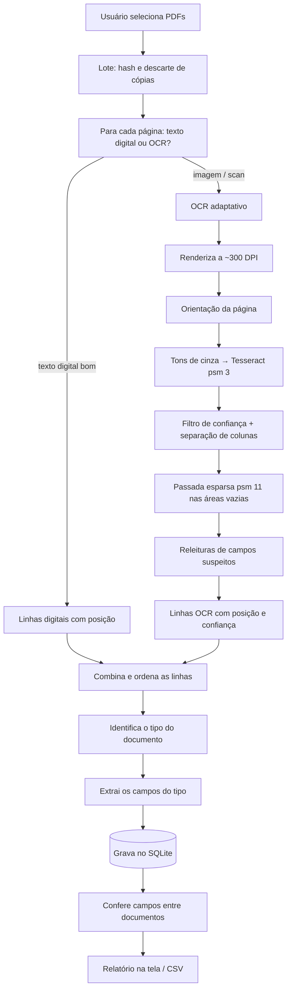

# Como o CEUMA funciona

Este documento explica **o que o CEUMA faz**, **quais tecnologias usa e por quê**, **quais decisões de projeto guiam o código** e, principalmente, **o caminho completo de um documento**, desde o PDF que entra até o relatório que sai. Ele foi escrito para ser lido do começo ao fim por quem está chegando no projeto. Cada etapa aponta o arquivo e a função onde ela acontece, para você poder abrir o código e acompanhar.

> Documento irmão: [HISTORICO_DE_CORRECOES.md](HISTORICO_DE_CORRECOES.md) conta os problemas encontrados, como foram investigados e o efeito medido de cada correção.

---

## Sumário

1. [O problema que o CEUMA resolve](#1-o-problema-que-o-ceuma-resolve)
2. [O que ele faz e o que ele não faz](#2-o-que-ele-faz-e-o-que-ele-não-faz)
3. [Tecnologias e por que cada uma foi escolhida](#3-tecnologias-e-por-que-cada-uma-foi-escolhida)
4. [Decisões de projeto (os princípios por trás do código)](#4-decisões-de-projeto-os-princípios-por-trás-do-código)
5. [Arquitetura: como o código está organizado](#5-arquitetura-como-o-código-está-organizado)
6. [O caminho de um documento, passo a passo](#6-o-caminho-de-um-documento-passo-a-passo)
7. [Glossário de status](#7-glossário-de-status)
8. [Configuração por variáveis de ambiente](#8-configuração-por-variáveis-de-ambiente)
9. [Testes: como o projeto se protege de regressões](#9-testes-como-o-projeto-se-protege-de-regressões)
10. [Limitações conhecidas e próximos passos](#10-limitações-conhecidas-e-próximos-passos)
11. [Roteiro sugerido para o pitch](#11-roteiro-sugerido-para-o-pitch)

---

## 1. O problema que o CEUMA resolve

Em processos como matrícula, admissão ou cadastro, alguém precisa **conferir documentos pessoais**: ler RG, CNH, certidões e carteira de trabalho, copiar nome, CPF e datas, e verificar se as informações batem entre os documentos. Feito à mão, esse trabalho é:

- **lento**: cada documento é lido e digitado;
- **sujeito a erro**: um dígito trocado num CPF passa despercebido;
- **sensível**: são dados pessoais protegidos pela LGPD, que não deveriam ir para serviços na nuvem sem necessidade.

O CEUMA automatiza a parte repetitiva, que é **ler, extrair e comparar**. A decisão final continua com uma pessoa.

## 2. O que ele faz e o que ele não faz

**Faz:**

- Lê PDFs com texto digital e PDFs que são fotos ou digitalizações. Nesses casos usa **OCR** (*Optical Character Recognition*, reconhecimento óptico de caracteres), que transforma a imagem de um texto em texto.
- Identifica o tipo do documento: RG, CIN (a nova Carteira de Identidade Nacional), CNH, certidão de nascimento, certidão de casamento, CTPS física e digital, comprovante de solicitação de CTPS, declaração de vínculo e contrato de trabalho.
- Extrai os campos de cada tipo (nome, CPF, RG, datas, filiação etc.) e guarda **de qual página veio cada valor**.
- Compara nome, CPF e data de nascimento **entre documentos** e aponta o que é compatível e o que diverge.
- Funciona em dois modos: **individual** (todos os documentos são da mesma pessoa) e **familiar** (documentos de pessoas diferentes, ligados a cada uma).
- Gera relatório na tela e exportação CSV.

**Não faz, por decisão de projeto:**

- **Não autentica documentos.** Não detecta falsificação.
- **Não decide elegibilidade.** Não aprova nem reprova ninguém.
- **Não envia nada para a internet.** Todo o processamento é local.

Essas fronteiras aparecem no próprio README e são importantes no pitch: o sistema **apoia** a conferência humana, não a substitui.

---

## 3. Tecnologias e por que cada uma foi escolhida

| Tecnologia | Para que serve no projeto | Por que ela |
|---|---|---|
| **Python 3.12** | Linguagem de todo o sistema | Ótimo ecossistema para processamento de texto e imagem; fácil de ler; roda em Windows e macOS. O 3.12 foi fixado porque o PaddleOCR ainda não tem pacote para versões mais novas. |
| **Tkinter** | Interface gráfica (janela, botões, tabelas) | Já vem com o Python, sem instalação extra. Simples e suficiente para um aplicativo de mesa. |
| **PyMuPDF** (`pymupdf`/`fitz`) | Abrir PDFs, ler a camada de texto digital, localizar imagens na página, renderizar regiões como imagem e converter cores | É rápido, não depende de programas externos e dá acesso fino à estrutura do PDF (posição de cada linha, matriz de transformação de cada imagem). |
| **NumPy** | Manipular imagens como matrizes de pixels (recortar, rotacionar, medir variação) | É o padrão do Python para cálculo numérico; as imagens renderizadas viram arrays sem cópia. |
| **Tesseract OCR** (programa externo) | Motor de OCR principal, em português (`por`) | Gratuito, *open source*, roda offline, leve (funciona em máquina de 4 GB) e devolve **posição e confiança de cada palavra** no formato TSV, informação essencial para o projeto. |
| **PaddleOCR** (opcional) | Classificador de orientação da página e OCR "avançado" (mais pesado e mais preciso em fotos difíceis) | Modelos de deep learning muito bons em fotos, mas pesados (centenas de MB, mais memória). Por isso é opcional e roda isolado em outro processo. |
| **SQLite** | Banco de dados local das análises | Vem com o Python, é um único arquivo, não precisa de servidor e suporta transações. |
| **unittest + pytest** | Testes automatizados | Os testes são escritos com `unittest` (biblioteca padrão) e executados pelo `pytest`, que tem saída melhor e mais recursos. |
| **uv** | Criar o ambiente virtual e instalar dependências | Muito mais rápido que o `pip`; instala a versão certa do Python sozinho. |
| **pyproject.toml** | Declarar dependências, comandos (`ceuma`, `ceuma-demo`) e configuração do pytest | É o padrão moderno de projetos Python (PEP 621). |
| **Git** | Versionamento, com um commit por objetivo e mensagens em português no padrão `feat:/fix:/refactor:/docs:/chore:` | Histórico legível e fácil de reverter. |

---

## 4. Decisões de projeto (os princípios por trás do código)

Entender estes princípios explica por que muito do código é "desconfiado" e cheio de verificações.

### 4.1 Privacidade primeiro: tudo local

Documentos pessoais nunca saem da máquina. O OCR avançado roda num subprocesso que **bloqueia conexões de rede** (`_executar_ocr_local` em `leitura/ocr/paddle.py` instala um *audit hook* que recusa `socket.connect`). O banco guarda as análises por **24 horas** e depois as apaga (`banco/retencao.py`).

### 4.2 Humano no circuito (*human-in-the-loop*)

O sistema nunca "chuta". Quando não tem certeza, ele **marca para revisão** em vez de preencher. É por isso que existem status como `EVIDENCIA_INSUFICIENTE`, `AMBIGUO` e `REVISAO_NECESSARIA` ([seção 7](#7-glossário-de-status)).

### 4.3 Conservador: é melhor "não encontrado" do que "encontrado errado"

Um campo vazio leva a pessoa a conferir o original. Um campo errado com cara de certo engana. Por isso:

- o CPF só é aceito se os **dígitos verificadores** baterem (`validar_cpf` em `extracao/campos.py`);
- datas precisam ser válidas no calendário;
- o CPF só é atribuído ao **titular** quando o contexto prova isso. Um CPF dentro do bloco de filiação, por exemplo, pode ser do pai ou da mãe.

### 4.4 Decisão por evidências combinadas, não por uma palavra só

Para dizer que um PDF é um RG, o identificador não procura só a palavra "IDENTIDADE": ele junta **sinais** (título, órgão emissor, rótulo "REGISTRO GERAL", frase de validade nacional, rótulos pessoais) e exige **combinações** deles. Se dois tipos ficam igualmente prováveis, o resultado é `AMBIGUO` e não um palpite.

### 4.5 A posição na página importa (associação espacial)

Em documentos de identidade o rótulo ("NOME", "CPF") e o valor nem sempre estão na mesma linha de texto: o valor costuma estar **à direita** ou **logo abaixo**. Por isso o OCR guarda a **caixa** (retângulo) de cada linha, e o extrator associa rótulo e valor pela geometria (`extracao/associador_espacial.py`).

### 4.6 Rastreabilidade

Todo valor extraído carrega **a página de origem** e **o método de leitura** (digital ou OCR). Quem revisa sabe onde olhar.

### 4.7 Atomicidade: ou grava tudo, ou não grava nada

Um lote inteiro (documentos, campos, conferências e o status da análise) é gravado numa **única transação** do SQLite (`processar_lote` em `processamento/lote.py`). Se qualquer coisa falhar no meio, é feito *rollback* e o banco não fica pela metade.

### 4.8 Orçamento de tempo

O OCR tem limite de tempo por página e por documento (`LeitorAdaptativo` em `leitura/ocr/adaptativo.py`). Num computador fraco, um PDF problemático não pode travar o lote inteiro. Quando o prazo acaba, a página é marcada para revisão.

### 4.9 Testes com dados fictícios

Nenhum documento real entra no repositório. Os testes geram PDFs e CPFs sintéticos, e o `.gitignore` bloqueia PDFs, imagens, bancos e planilhas.

---

## 5. Arquitetura: como o código está organizado

O código está no pacote `src/ceuma/`, dividido **por etapa do fluxo**. Cada pasta tem uma responsabilidade:

```
src/ceuma/
├── __main__.py          python -m ceuma → abre a janela
├── demo.py              gera PDFs fictícios e abre a janela em modo demonstração
├── leitura/             PDF → linhas de texto com posição
│   ├── pdf.py           ler_pdf(): percorre as páginas do PDF
│   ├── pagina.py        ler_pagina(): decide entre texto digital e OCR, por região
│   └── ocr/
│       ├── tesseract.py     adaptador do Tesseract (subprocesso + leitura do TSV)
│       ├── adaptativo.py    LeitorAdaptativo: orçamento, modos de leitura, releituras
│       ├── paddle.py        PaddleOCR (orientação e OCR avançado isolado)
│       └── orientacao.py    prepara o classificador de orientação em segundo plano
├── extracao/            ferramentas genéricas de extração
│   ├── campos.py            nomes, CPFs (com dígito verificador), RG, datas
│   ├── associador_espacial.py   liga rótulo e valor pela posição
│   ├── datas_extenso.py     datas por extenso ("primeiro de janeiro de...")
│   └── ...
├── documentos/          conhecimento específico de cada tipo de documento
│   ├── identificador.py     qual é o tipo deste documento?
│   ├── analisador.py        orquestra identificação + extração
│   └── identidade.py, cnh.py, certidao_*.py, ctps_*.py, ...
├── conferencia/         compara campos entre documentos
├── banco/               SQLite: conexão, esquema, gravação, retenção
├── relatorios/          monta o relatório e exporta CSV
├── processamento/       lote.py: orquestra o lote inteiro
└── interface/           janela Tkinter
```

Dependências entre as camadas (quem usa quem):



> **Ponto de atenção arquitetural:** `leitura/` também chama `documentos/` em dois lugares, para decidir se a camada digital já basta e para validar a orientação pelo texto. É uma dependência "para trás" no fluxo, deixada assim de propósito por enquanto. Ver [seção 10](#10-limitações-conhecidas-e-próximos-passos).

---

## 6. O caminho de um documento, passo a passo

Visão geral:



Agora cada etapa em detalhe. Como exemplo, acompanhe **um RG fotografado com o celular e convertido em PDF**: uma página com uma única imagem, sem texto digital.

### Passo 0: abrir o aplicativo e criar uma análise

- **Onde:** `interface/janela_principal.py` (`JanelaPrincipal`) e `banco/conexao.py` (`criar_analise`).
- A janela abre o banco SQLite (em `dados_ceuma/documentos.db`, ou na pasta de `CEUMA_DADOS`), cria as tabelas se for a primeira vez e roda a **limpeza das análises expiradas** (mais de 24 h).
- Ao iniciar, cria-se uma **análise**: um registro com código, data de criação e data de expiração. Tudo do lote fica ligado a ela.

### Passo 1: seleção e preparação do lote

- **Onde:** `processamento/lote.py`, função `processar_lote`.
- O usuário escolhe uma pasta ou arquivos. Só `.pdf` é aceito.
- Para cada arquivo é calculado o **SHA-256** do conteúdo. Se dois arquivos têm o mesmo hash, são o mesmo documento: a cópia é ignorada e registrada como duplicata.
- Abre-se uma transação (`BEGIN IMMEDIATE`) que só será confirmada no fim do lote ([4.7](#47-atomicidade-ou-grava-tudo-ou-não-grava-nada)).
- É criado **um único leitor de OCR** para o lote todo, para não recarregar modelos a cada arquivo. O prazo de OCR dele é **reiniciado a cada documento** (`iniciar_documento`).

### Passo 2: abrir o PDF e percorrer as páginas

- **Onde:** `leitura/pdf.py`, função `ler_pdf`.
- Recusa PDF protegido por senha.
- Para cada página chama `ler_pagina` e anota em cada linha a `pagina_origem`.
- Guarda um **diagnóstico de OCR** por página (`diagnostico_ocr`): pendências como `ORCAMENTO_ESGOTADO` e métricas como quantas vezes o Tesseract rodou e quanto tempo levou.

### Passo 3: decidir entre texto digital e OCR

- **Onde:** `leitura/pagina.py`, função `ler_pagina`.
- O PyMuPDF extrai a **camada de texto digital** (`_linhas_digitais`). PDFs gerados por computador já têm o texto pronto, e aí OCR é desnecessário e só pioraria o resultado.
- Localiza as **imagens** da página (`_regioes_de_imagem`) e calcula quanto da página a maior imagem cobre.
- Classifica a **composição** da página:
  - `DIGITAL`: só texto;
  - `DIGITALIZADA`: uma imagem cobre a página (scan ou foto), como no nosso RG;
  - `DIGITALIZADA_COM_CAMADA`: scan com texto invisível por cima (comum em scanners com OCR próprio);
  - `MISTA`: texto e imagens.
- **Atalho da camada suficiente:** se é um scan com camada de texto, o sistema primeiro tenta analisar só essa camada. Se ela já identifica o documento e traz nome e um dado civil válido, o OCR é dispensado.
- Senão, decide **onde** fazer OCR:
  - imagem cobrindo 85% ou mais da página → OCR da **página inteira**;
  - imagens menores → OCR de **cada imagem recortada** e, se nada útil sair, nova tentativa na página inteira.

No nosso RG: composição `DIGITALIZADA`, sem texto digital, então OCR da página inteira.

### Passo 4: OCR adaptativo

Este é o coração da leitura de fotos. As melhorias descritas no histórico se concentram aqui.

#### 4a. Renderizar a região como imagem (~300 DPI)

- **Onde:** `leitura/pagina.py`, `_ler_imagem`.
- A região é renderizada em RGB a **cerca de 300 DPI** (`_ESCALA_OCR = 300/72`, ou seja, 300 pixels por polegada, e a polegada tem 72 pontos de PDF). É a resolução para a qual o Tesseract foi pensado: letras pequenas precisam de pixels suficientes.
- Há tetos de segurança (`_MAX_PIXELS = 5 milhões` e `_MAX_LADO = 3600 px`) para não estourar memória.
- **Duas escalas diferentes:** a imagem do OCR usa ~4,17 px por ponto, mas todas as caixas devolvidas são convertidas para uma escala fixa de **2 px por ponto** (`_ESCALA_COORDENADAS`), a "escala de coordenadas". Assim as regras de distância do extrator (por exemplo "no máximo 32 px de distância") não mudam quando a resolução do OCR muda.

#### 4b. Orientação: a página está de cabeça para baixo?

- **Onde:** `LeitorAdaptativo.classificar_orientacao` (`leitura/ocr/adaptativo.py`) e `_ler_imagem`.
- **Atalho textual:** na primeira leitura, o Tesseract lê a imagem como está. Se saem pelo menos 4 linhas com confiança ≥ 0,80 e o identificador reconhece o documento, a página está em pé, e o classificador pesado nem é carregado.
- Senão, o modo padrão usa o **classificador de orientação do PaddleOCR** (estima 0°, 90°, 180° ou 270°). Se a estimativa for conclusiva, a imagem é girada antes do OCR.
- Sem os modelos do Paddle, o resultado é `INDISPONIVEL` e o fluxo segue com a orientação declarada no PDF.

#### 4c. Tesseract com análise de layout (`psm 3`)

- **Onde:** `leitura/ocr/tesseract.py` (classe `Tesseract`) e `LeitorAdaptativo._psm`.
- A imagem é convertida para **tons de cinza pela conversão do MuPDF**, que clareia bastante o verde e o vermelho saturados dos fundos de segurança, e enviada como PNG ao executável do Tesseract por `stdin`, com idioma `por`.
- O **PSM** (*Page Segmentation Mode*) diz ao Tesseract como a imagem está organizada:
  - `psm 3`: análise automática de layout (colunas, blocos). É o padrão para páginas e regiões.
  - `psm 7`: uma única linha de texto. Usado em faixas estreitas e nas releituras de um campo.
  - `psm 11`: texto esparso, ou seja, "ache qualquer texto, em qualquer lugar".
- O Tesseract responde em **TSV**: uma linha por palavra, com posição, tamanho e **confiança (0–100)**.

#### 4d. Limpeza do TSV

- **Onde:** `_tsv` e `_separar_colunas` em `leitura/ocr/tesseract.py`.
1. Agrupa as palavras por linha (bloco, parágrafo, linha).
2. **Separa colunas unidas:** se duas palavras da mesma linha estão a mais de **3 alturas de letra** de distância, são campos diferentes ("NATURALIDADE" … "DATA DE NASCIMENTO") e viram linhas separadas, cada uma com sua caixa.
3. **Descarta palavras com confiança < 40**, que são lixo lido de bordas, brasões e tramas de segurança. O descarte acontece **depois** da separação de colunas, para que o buraco deixado por uma palavra descartada não pareça um vão entre colunas.

#### 4e. Passada esparsa (`psm 11`)

- **Onde:** `LeitorAdaptativo.reconhecer` e `_fora_das_linhas`.
- A análise de layout tende a ignorar **rótulos miúdos e isolados** e **números em tinta colorida**, como o número do RG impresso em vermelho. Uma segunda leitura com `psm 11` os encontra.
- Só entram as linhas da segunda leitura que **não se sobrepõem** (menos de 20% da área) ao que a primeira já leu, e que têm pelo menos 2 caracteres.

#### 4f. Releituras de campos suspeitos

- **Onde:** `LeitorAdaptativo.reconhecer` e `_reler`.
- Se uma linha parece `CPF: ...` ou `DATA DE NASCIMENTO: ...` mas o valor é inválido ou está vazio, o leitor **recorta só aquele trecho**, melhora o contraste, amplia 2× e relê em `psm 7`.
- Um valor recuperado só é aceito se **duas leituras concordarem**. Se divergirem, fica a pendência `CAMPO_REQUER_REVISAO`.

#### 4g. Orçamento

- Cada chamada ao Tesseract conta uma **tentativa** (até 6 por página) e consome tempo do **prazo da página (15 s)** e do **documento (60 s)**.
- Sem prazo ou tentativas, o leitor para e registra `ORCAMENTO_ESGOTADO` ou `LIMITE_TENTATIVAS`, e o documento vai para revisão.

### Passo 5: juntar e ordenar as linhas

- **Onde:** `leitura/pagina.py`, `_combinar`, `_ordenar` e `_ordenar_grupos`.
- Linhas digitais e de OCR são combinadas. Quando as duas leem o mesmo trecho, a duplicata é descartada.
- As linhas são ordenadas em ordem de leitura (de cima para baixo e da esquerda para a direita, por faixas).
- O resultado da página tem `texto`, `linhas` (cada uma com texto, caixa, confiança e origem), `metodo` (`DIGITAL`, `OCR`, `HIBRIDO` ou `SEM_TEXTO`) e `composicao`.

### Passo 6: identificar o tipo do documento

- **Onde:** `documentos/identificador.py`, `identificar_documento`.
- Normaliza o texto: maiúsculas, sem acentos, junta palavras hifenizadas na quebra de linha.
- Procura **títulos** tolerando erros de OCR. Um título pode estar quebrado em até 3 linhas; até 2 palavras podem diferir, se forem ≥ 84% parecidas. Fragmentos curtos de ruído (≤ 2 caracteres) depois do título são ignorados.
- Coleta **sinais** de cada tipo. Para o RG tradicional, por exemplo:
  - título "CARTEIRA DE IDENTIDADE";
  - órgão emissor (Secretaria de Segurança, Instituto de Identificação, Polícia Civil);
  - rótulo "REGISTRO GERAL" ou "RG";
  - frase "VALIDA EM TODO O TERRITORIO NACIONAL";
  - rótulos pessoais (NOME, FILIAÇÃO, DATA DE NASCIMENTO).
- Aplica **regras de combinação**. Um RG é confirmado, entre outras regras, por *título + rótulo RG*, ou *órgão emissor + rótulo RG + rótulos pessoais*, ou *título + validade nacional + rótulos pessoais*.
- Resultado:
  - `IDENTIFICADO`: exatamente um tipo confirmado;
  - `AMBIGUO`: mais de um;
  - `EVIDENCIA_INSUFICIENTE`: há sinais, mas não bastam;
  - `NAO_IDENTIFICADO`: nenhum sinal.

  As evidências usadas vão junto no resultado, para a revisão humana.

No nosso RG: `IDENTIFICADO` como `DOCUMENTO_IDENTIDADE`, com as evidências título, validade nacional e campos de identificação.

### Passo 7: extrair os campos

- **Onde:** `documentos/analisador.py` (`analisar_documento`) chama o extrator do tipo. Para RG e CIN é `documentos/identidade.py` (`extrair_identidade` e `extrair_campos_perfil`).
- Cada tipo tem um **perfil**: a lista de rótulos aceitos para cada campo (por exemplo, `CPF` ← "CPF", "CPF DO TITULAR"…), os validadores e as regras de titularidade.
- A extração usa dois caminhos em paralelo:
  1. **Textual:** "rótulo: valor" na mesma linha do texto.
  2. **Espacial:** usa as caixas. Para cada rótulo, procura um valor **à direita** (até 32 px, alinhado pelo menos 50% na vertical) ou **abaixo** (até 100 px, sobreposto pelo menos 20% na horizontal). Rótulos miúdos impressos rente ao valor podem ter caixas que se cruzam até 30% da altura e ainda contam como "abaixo".
- Cada valor é **validado** (CPF pelo dígito verificador, datas pelo calendário). Se dois candidatos diferentes disputam o mesmo campo, o campo fica `AMBIGUO`.
- **Titularidade do CPF:** o CPF só vira `ENCONTRADO` e com papel `TITULAR` quando o rótulo é explícito ("CPF DO TITULAR") ou quando o rótulo "CPF" aparece no contexto de nome ou data de nascimento e **fora** do bloco de filiação. Caso contrário fica `EVIDENCIA_INSUFICIENTE`.
- Também são calculadas **pendências de leitura** (`CLASSIFICACAO_INCONCLUSIVA`, `NOME_NAO_CONFIRMADO`, `CAMPO_REQUER_REVISAO`…).

No nosso RG saem nome, CPF (titular), número do RG, data de nascimento, data de expedição, filiação e naturalidade, sem pendências.

### Passo 8: gravar no banco

- **Onde:** `banco/persistencia.py`, `salvar_resultado_analise`.
- Grava o documento (tipo, número de páginas, `status_leitura` = `CONCLUIDO` ou `REVISAO_NECESSARIA`) e os campos com valor, status e página de origem. Tudo ainda dentro da transação do lote.

Tabelas principais:

| Tabela | Conteúdo |
|---|---|
| `analises` | Cada análise: código, criação, expiração, status (`EM_ANDAMENTO`/`CONCLUIDA`) |
| `documentos` | Cada PDF: arquivo, tipo identificado, páginas, status de leitura, escopo |
| `campos_extraidos` | Cada campo: nome, valor, página, status |
| `conferencias` | Resultado da comparação de cada campo entre documentos |
| `pessoas`, `documentos_pessoas` | Modo familiar: quem é quem e quais documentos são de quem |
| `itens_documentais`, `campos_item` | Itens repetidos dentro de um documento (por exemplo, cada contrato numa CTPS) |

O esquema tem **versão** (`PRAGMA user_version`, hoje 2) e migração automática (`banco/esquema.py`).

### Passo 9: conferir entre documentos

- **Onde:** `conferencia/automatica.py` (`conferir_analise`) e `conferencia/comparador.py` (`comparar_campo`).
- Agrupa os documentos elegíveis: todos juntos no modo individual, ou por pessoa no modo familiar.
- Para cada par de documentos compara **NOME, CPF e DATA_NASCIMENTO** depois de normalizar (maiúsculas, sem acentos, espaços únicos):
  - `COMPATIVEL`: iguais;
  - `DIVERGENTE`: diferentes;
  - `NAO_CONFERIDO`: um dos lados não tem o valor.
- Grava em `conferencias`. Por fim a análise vira `CONCLUIDA` e a transação é confirmada (`commit`).

### Passo 10: relatório, revisão e exportação

- **Onde:** `relatorios/relatorio.py` (`recuperar_relatorio`), `relatorios/exportador_csv.py` e a interface.
- A janela mostra os documentos, os campos de cada um (valor, página, status), as conferências e as pendências.
- **Releitura avançada:** se o OCR teve pendências, o botão "Reprocessar com OCR avançado" relê o documento com o PaddleOCR completo, num processo isolado e sem rede. Uma releitura bem-sucedida cria **outra análise** e preserva a anterior.
- **Exportação CSV:** só é feita se a análise continua válida. O arquivo é escrito primeiro num temporário e publicado sem sobrescrever outro sem confirmação. Valores que começam com `=`, `+`, `-` ou `@` são neutralizados, para evitar **injeção de fórmulas** quando o CSV é aberto no Excel.
- **Recuperar relatório:** pelo código da análise, enquanto não expirar.

### Passo 11: retenção

- **Onde:** `banco/retencao.py` e `limpar_analises_expiradas`.
- Com a janela aberta, a limpeza roda periodicamente (a cada 60 s) e também na abertura seguinte. Análises com mais de 24 h são apagadas.
- CSVs já exportados ficam sob responsabilidade de quem os salvou.

---

## 7. Glossário de status

**Identificação do documento**

| Status | Significado |
|---|---|
| `IDENTIFICADO` | Um único tipo confirmado por combinação de sinais |
| `AMBIGUO` | Mais de um tipo confirmado; precisa de revisão |
| `EVIDENCIA_INSUFICIENTE` | Há sinais de algum tipo, mas não o bastante |
| `NAO_IDENTIFICADO` | Nenhum sinal reconhecido |

**Campos**

| Status | Significado |
|---|---|
| `ENCONTRADO` | Valor achado e válido |
| `NAO_ENCONTRADO` | Rótulo e valor não foram achados |
| `EVIDENCIA_INSUFICIENTE` | Algo foi visto (por exemplo, o rótulo, ou um CPF sem prova de que é do titular), mas não basta para confirmar |
| `INVALIDO` | Valor achado mas reprovado na validação (CPF com dígito errado, data impossível) |
| `AMBIGUO` | Mais de um valor diferente disputa o campo |
| `NAO_APLICAVEL` | O campo não existe nesse tipo (por exemplo, RG separado numa CIN) |

**Pendências de OCR (por página)**

| Pendência | Significado |
|---|---|
| `ORCAMENTO_ESGOTADO` | Acabou o prazo de OCR da página ou do documento |
| `LIMITE_TENTATIVAS` | Acabaram as chamadas ao Tesseract permitidas na página |
| `TESSERACT_INDISPONIVEL` | Executável do Tesseract não encontrado |
| `IDIOMA_PORTUGUES_INDISPONIVEL` | Tesseract sem o pacote `por` |
| `ORIENTACAO_INDISPONIVEL` | Classificador de orientação (Paddle) ausente |
| `SEM_TEXTO_UTIL` | O OCR não devolveu nada aproveitável |
| `CAMPO_REQUER_REVISAO` | Um campo lido parece inválido ou vazio |

---

## 8. Configuração por variáveis de ambiente

| Variável | Efeito | Padrão |
|---|---|---|
| `CEUMA_DADOS` | Pasta do banco SQLite | `dados_ceuma/` na raiz do projeto |
| `CEUMA_TESSERACT` | Caminho do executável do Tesseract | Busca automática (instalação padrão do Windows, Homebrew no macOS, `PATH`) |
| `CEUMA_OCR_MODO` | `adaptativo`, `tesseract` (sem correções) ou `paddle` (motor pesado) | `adaptativo` |
| `CEUMA_OCR_ORIENTACAO` | `paddle`, `osd` (Tesseract, experimental) ou `pdf` (confia no PDF) | `paddle` |
| `CEUMA_OCR_SEGUNDOS_PAGINA` | Prazo de OCR por página | 15 |
| `CEUMA_OCR_SEGUNDOS_DOCUMENTO` | Prazo de OCR por PDF (recomeça a cada documento) | 60 |
| `CEUMA_OCR_FALLBACK_PADDLE` | `1` liga o Paddle como reforço automático | desligado |
| `CEUMA_OCR_RESERVA_PADDLE` | Segundos livres exigidos antes do reforço Paddle | 35 |

Detalhes em [OCR.md](OCR.md).

---

## 9. Testes: como o projeto se protege de regressões

- **Onde:** `tests/` (automatizados) e `scripts/manuais/` (scripts que imprimem resultados para inspeção manual).
- **Como rodar:** `.venv/bin/python -m pytest` (macOS) ou `.\.venv\Scripts\python.exe -m pytest` (Windows). Hoje são **391 testes** passando, em cerca de 12 s.
- **Estratégias usadas:**
  - **Dados sintéticos:** PDFs gerados na hora com PyMuPDF e Pillow, e CPFs fictícios válidos (`cpf_sintetico`).
  - **Dublês (*mocks*):** o Tesseract e o Paddle são substituídos por simuladores (`OCRSimulado`, `Mock`) que devolvem linhas controladas. Assim os testes rodam rápido, sem os motores instalados, e testam a **lógica** e não o motor.
  - **Testes de fronteira:** por exemplo, `teste_diagnostico_geometrico.py` fixa exatamente até onde o associador aceita um par rótulo–valor (1 px a mais e muda a decisão).
  - **Testes de integração:** `teste_mvp_visual.py` sobe a janela de verdade e percorre o fluxo completo. Dois deles usam o Tesseract real quando ele está instalado.
- **Regra de ouro adotada nas correções:** medir a suíte **antes** de mexer (linha de base) e exigir que ela continue verde **depois**. Toda regra nova ganhou teste próprio.

---

## 10. Limitações conhecidas e próximos passos

1. **Validar com mais documentos reais.** As correções de OCR foram medidas com um RG fotografado real e com os PDFs fictícios. Ainda faltam RGs de outros estados, CIN, CNH, certidões e documentos digitalizados em scanner.
2. **Validar no computador de 4 GB.** A leitura ficou mais pesada (300 DPI e duas passadas): ~1,6 s por página aqui. É preciso medir na máquina-alvo e ajustar os prazos se for o caso.
3. **Reforço do Paddle ainda impossível com os padrões.** Ele exige 35 s livres (`CEUMA_OCR_RESERVA_PADDLE`) e a página só tem 15 s, então o reforço automático nunca roda, mesmo ligado. Ver o histórico.
4. **Dependência "para trás" `leitura → documentos`.** Um próximo passo arquitetural é a leitura devolver só o texto e a decisão "a camada digital basta?" subir para o `processamento`.
5. **Scripts manuais desatualizados.** `scripts/manuais/teste_operacoes.py` está quebrado (`no such table: analises`) e 5 scripts exigem um PDF real em `pdf/jpg2pdf.pdf`. Vale converter os úteis em testes automatizados e apagar o resto.
6. **Modo familiar:** a interface consulta os vínculos, mas criar pessoas e editar atribuições ainda depende das funções internas (`banco/atribuicoes.py`).

---

## 11. Roteiro sugerido para o pitch

1. **Problema (30 s):** conferir documentos pessoais à mão é lento, sujeito a erro e envolve dados sensíveis.
2. **Solução (30 s):** aplicativo de mesa que lê PDFs (digitais ou fotos), identifica o documento, extrai os campos e compara entre documentos, **100% offline**.
3. **Demonstração (1–2 min):** `python -m ceuma.demo` mostra o fluxo com documentos fictícios. Nunca use documento real numa apresentação.
4. **Como funciona (1 min):** o diagrama da [seção 6](#6-o-caminho-de-um-documento-passo-a-passo): camada digital × OCR, identificação por evidências, extração por posição, conferência.
5. **Decisões que mostram maturidade (1 min):**
   - privacidade: tudo local, retenção de 24 h, sem rede no OCR avançado;
   - humano no circuito: o sistema marca para revisão em vez de chutar;
   - conservador: CPF com dígito verificador, titularidade só com contexto;
   - atomicidade: transação única por lote;
   - testes: 391 testes automatizados com dados fictícios.
6. **Metodologia de melhoria (1 min):** o caso do RG fotografado, que saiu de "2 linhas de lixo" para "7 campos corretos", com diagnóstico medido etapa por etapa ([HISTORICO_DE_CORRECOES.md](HISTORICO_DE_CORRECOES.md)).
7. **Próximos passos (30 s):** a [seção 10](#10-limitações-conhecidas-e-próximos-passos).
